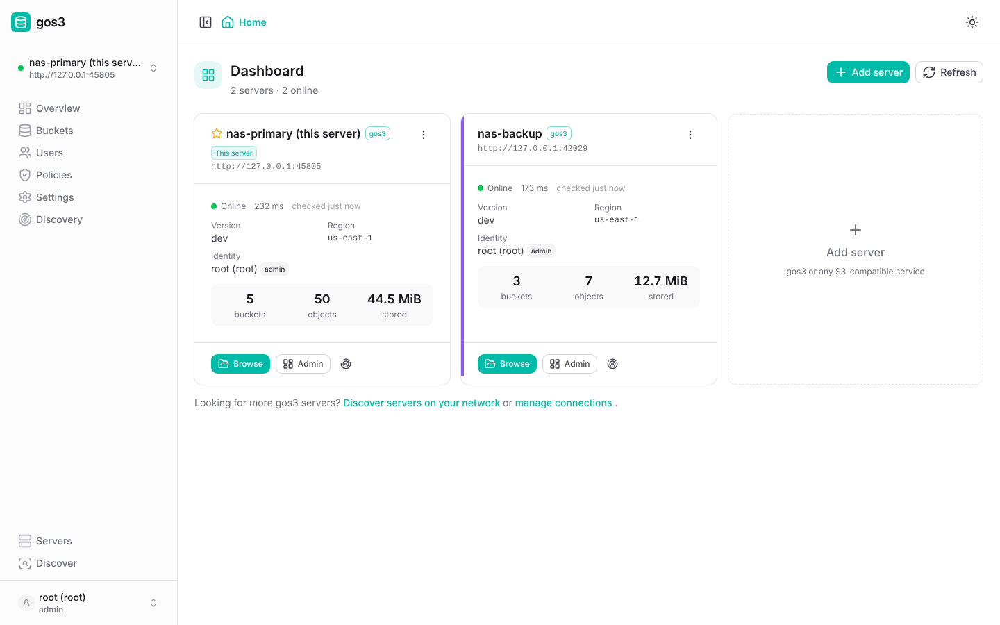
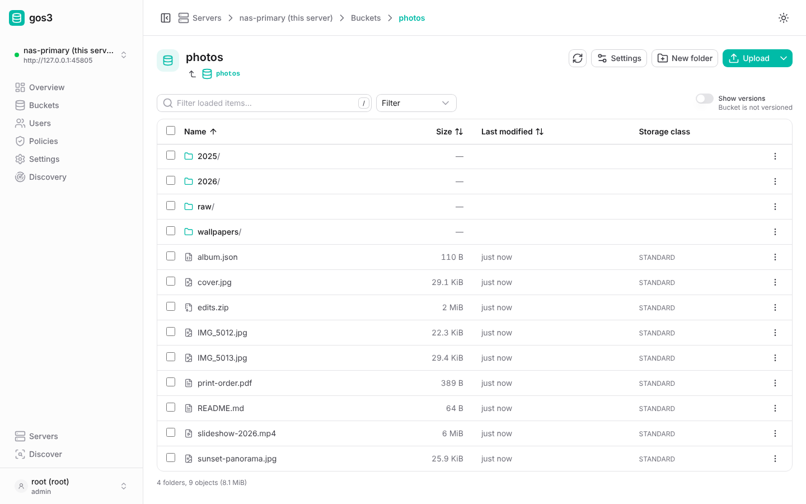
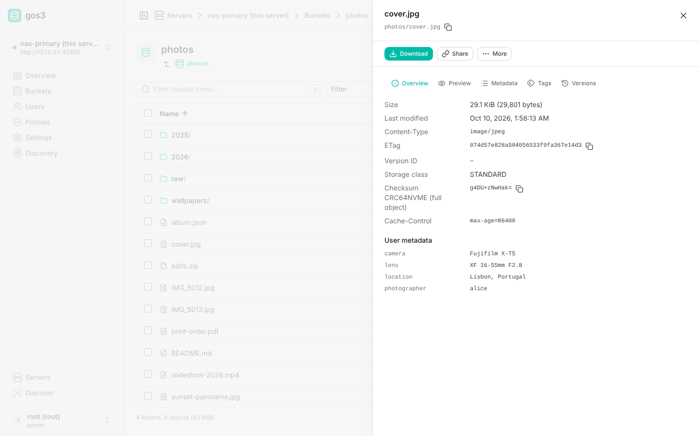
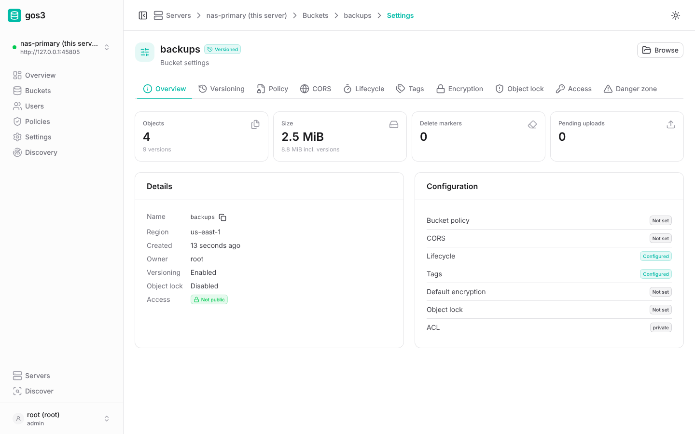
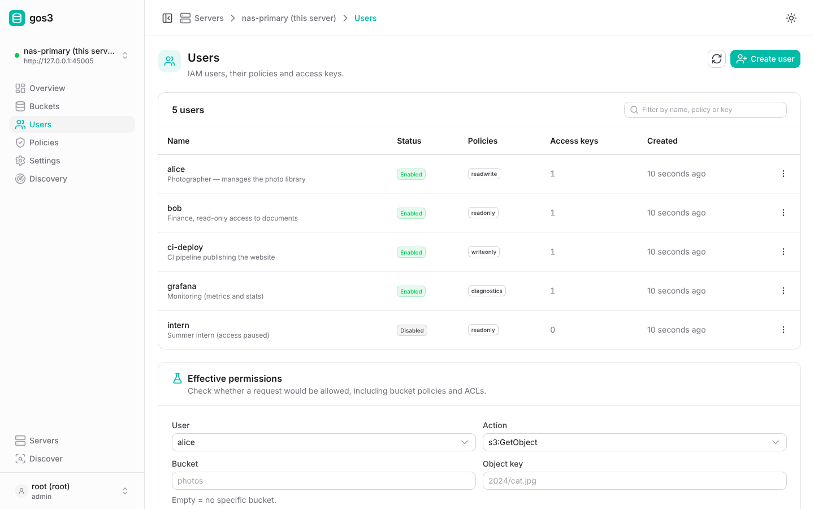
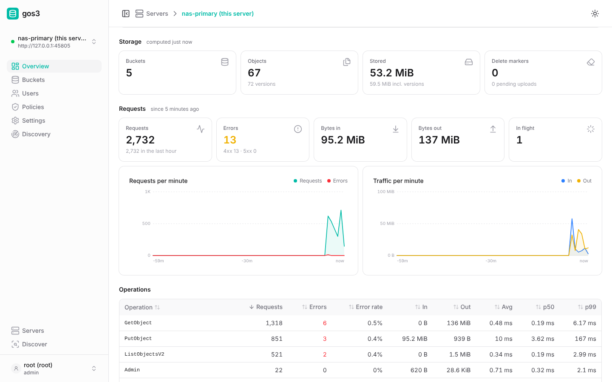
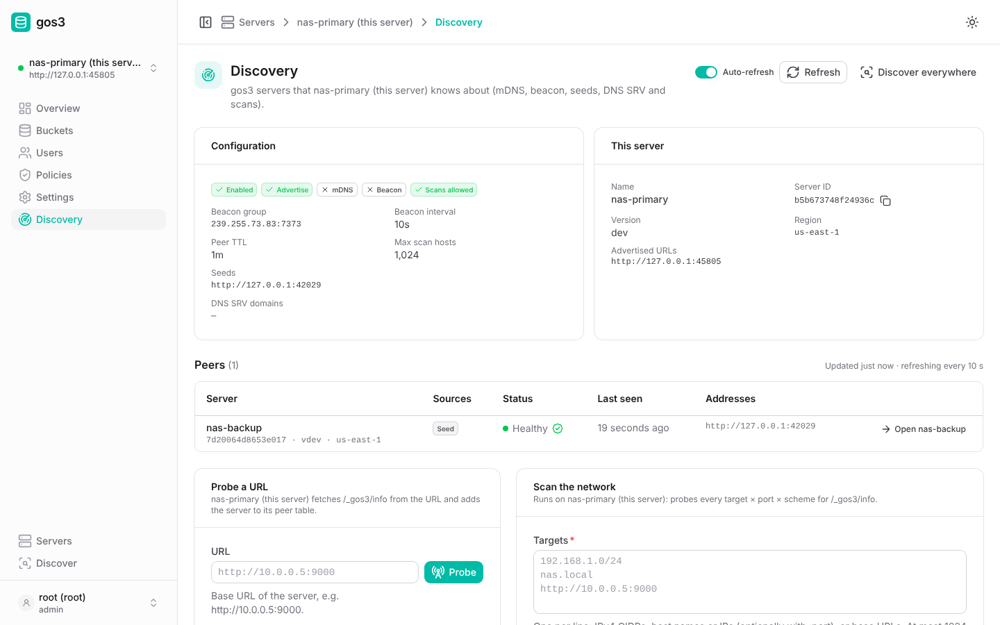
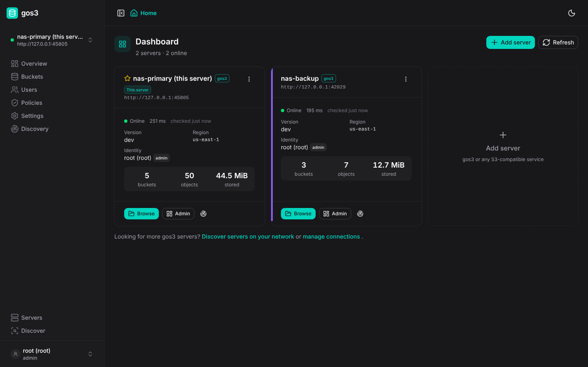
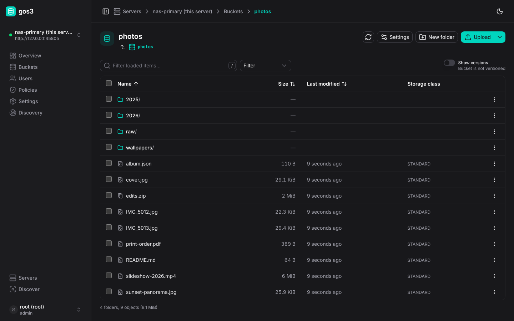

# Web UI

The gos3 web UI is a single-page app (Nuxt 4, TypeScript) for managing one or
more S3 servers: gos3 servers, and also any other S3-compatible service for the
bucket and object features. It runs in two modes built from the same code in
`web/`.

| | Embedded | Standalone |
|---|---|---|
| Where | Inside the gos3 binary, at `http://<server>:9000/_gos3/ui/` | A Node.js server (`node .output/server/index.mjs`), default port 3000 |
| Build | `make build` (or `cd web && pnpm generate:embed`, then `make build-go`) | `cd web && pnpm build`, or `docker build -f deploy/docker/web.Dockerfile .` |
| Default connection | The hosting gos3 server, detected automatically | None; add servers or ship presets |
| CORS needed | No for the hosting server (same origin); yes for other servers it manages | Yes, for every server |
| Local discovery (mDNS, beacon, scan from the UI host) | No (needs the Node server) | Optional, off by default (`GOS3_UI_LOCAL_DISCOVERY=true`) |
| Presets | `servers.json` baked in at build time | `NUXT_PUBLIC_SERVERS` at runtime, or `servers.json` at build time |

The UI works offline: fonts and icons are bundled, and it loads nothing from
the internet.

## What it does

- **Dashboard** of all configured servers with status, version and usage.
- **Buckets**: create and delete; versioning, policy editor with templates,
  CORS, lifecycle, tags, object lock, default encryption and ACL settings.
- **Object browser**: folders, drag-and-drop uploads (multipart with parallel
  parts and progress), downloads, delete, rename and copy, metadata and tag
  editors, versions, and presigned share links.
- **IAM** (gos3 only): users, access keys, policies, and a policy simulator.
- **Server overview and settings** (gos3 only): version, request metrics,
  storage and disk usage, and every runtime setting from
  [configuration.md](configuration.md#runtime-settings-settingsjson).
- **Discovery** (gos3 only): peers seen by each connected server, network
  scans, local discovery from the UI host, and one-click "add server".

Pages are shown according to the signed-in identity's permissions (from
`GET /_gos3/admin/v1/whoami`). For example, Users appears only with
`admin:CreateUser`. Creating a user with policies also needs `admin:UpdateUser`,
and with an initial access key (the create form's "Create an access key
now" option, on by default) also `admin:CreateAccessKey`. A role with only
`admin:CreateUser` gets a 403 from the create form unless it selects no
policies and clears that option.

- **Self-service keys.** A user without `admin:CreateUser` sees "My access
  keys" on the Users page: it lists the user's own keys and deletes them
  (except the key signing the session). Creating a key there needs a policy
  that explicitly allows `admin:CreateOwnAccessKey` (whoami capability
  `createOwnKeys`; no built-in policy except `admin` grants it, and it is
  always false for root, which has no IAM keys). Without it the "Create key"
  button is hidden and the card names the missing action. The "Own access
  keys" policy template grants it. With a server that does not report
  `createOwnKeys` yet, the UI assumes creation is allowed, as such servers
  allowed it unless explicitly denied.
- **Discovery probe.** "Probe a URL" on a server's Discovery page
  (`POST /discovery/probe`) needs `admin:ProbeNetwork` (whoami capability
  `probe`). Reading the peer table needs only `admin:GetDiscovery`, so the
  built-in `diagnostics` policy shows the peers but not the probe form; the
  card says that `admin:ProbeNetwork` is missing instead. With a server that
  does not report `probe` yet, the UI falls back to `discovery`
  (`admin:GetDiscovery`), the permission such servers checked.
- **Policy editor and simulator.** Admin actions are evaluated against
  `arn:gos3:admin:::user/<name>`, `arn:gos3:admin:::policy/<name>` and
  `arn:gos3:admin:::bucket/<name>` (see [admin-api.md](admin-api.md));
  `*` and `arn:gos3:admin:::*` match all of them. The policy editor lists
  these forms and the `admin:PolicyName` condition key (the policies a
  CreateUser / UpdateUser request attaches), and the "Manage some users"
  template scopes user management to a name pattern and to a list of
  attachable policies. Such a delegated manager still gets the Users page
  (it lists all users; actions on users outside the pattern are refused by
  the server and shown as errors). For an admin action the simulator asks for an admin
  resource instead of a bucket and key (empty = service level).

### Object browser notes

- Listings use `encoding-type=url` (ListObjectsV2, ListObjectVersions and
  ListMultipartUploads), so keys with any characters are shown correctly.
- Keys with `.` or `..` path segments (for example `a/../b`, created by
  other clients) cannot be read, previewed, downloaded, shared, tagged or
  edited from the browser, because browsers resolve such segments in URLs.
  The UI says so and still allows Copy, Move and Delete for them (their
  links use `?key=` / `?prefix=`). The UI itself never creates such keys:
  uploads, new folders, renames and copy/move destinations are validated.
- Copy, move and rename refuse a destination inside the source folder, and
  ask before overwriting existing objects at the destination.
- Uploads (including folder uploads and drag-and-drop) also ask before
  overwriting. Both check the server, not the rows on screen: with HeadObject
  for 20 keys or fewer, otherwise by listing the common prefix and then with
  HeadObject for the keys the listing did not reach (up to 500). When the
  check is incomplete (too many objects, or HeadObject denied, for example
  with 403), the UI asks too.
- Move, rename, restoring a version and the metadata editor rewrite the
  object, and keep a canned object ACL such as `public-read` (one extra
  GetObjectAcl per object; custom grants produce a warning). Keeping the ACL
  needs `s3:PutObjectAcl` where the server enforces it (gos3 and AWS do).
- Names are used as given: backslashes in uploaded file names stay in the
  key (they are not turned into `/`), and leading or trailing spaces in
  rename, copy/move destination folder and new-folder names are kept. Only
  empty or all-blank names are rejected.
- A non-ASCII `Content-Disposition` file name is stored in the RFC 6266 /
  RFC 5987 form (`filename="ascii"; filename*=UTF-8''…`). Other non-ASCII
  content in that header is rejected by the metadata editor.
- gos3 serves objects with `Content-Security-Policy: sandbox`, so an HTML or
  SVG object opened from a gos3 bucket in a browser tab (a download or share
  link) runs no scripts (see [security.md](security.md#object-responses)).



## Signing in and credentials

Every request is signed in the browser with AWS SigV4, both for the S3 API and
the admin API. There are no sessions or cookies. Admin API requests also sign
their payload: `X-Amz-Content-Sha256` is the hex SHA-256 of the exact body
sent (of the empty string when there is none), so a captured request cannot
be replayed with another body; gos3 rejects admin requests with a body whose
payload is not signed. (S3 requests keep `UNSIGNED-PAYLOAD`.) A connection is
`{name, endpoint, region, accessKeyId, secretAccessKey, kind, forcePathStyle}`,
where `kind` is `gos3` or `s3`.

- With "remember" on, the secret key is kept in the browser's `localStorage`.
  Otherwise it is kept in `sessionStorage` and is gone when the tab closes.
  Use "remember" only on a trusted device.
- Connections can be exported and imported as JSON, with or without secrets.
  Before importing, the dialog lists what each entry will do: add a server,
  update fields of an existing one (secret values are never shown), or skip
  it. An entry matches an existing connection by ID, or by endpoint and
  access key. An import never points an existing connection, and the secret
  stored with it, at another server: an entry that would change a
  connection's endpoint or kind is added as a separate server instead, with
  only the credentials the file itself holds. The embedded "this server"
  connection and presets are never changed by an import (matching entries
  for the same server are skipped), and imported entries cannot take their
  IDs. Changing the access key without a new secret clears the stored
  secret, and `remember` in a file is ignored: imported secrets stay in
  `sessionStorage` until you turn "remember" on (an import that replaces
  the secret of a remembered connection turns "remember" off).
- Several open tabs share connection changes (added, edited and removed
  connections and remembered secrets). The active server and secrets kept
  only for the session stay per tab.
- Downloads and share links are presigned URLs (up to 7 days).

## Embedded mode

`gos3 serve` serves the UI at `/_gos3/ui/` unless `ui.enabled` is false
(`--no-ui`). An anonymous browser opening `/` is redirected there unless
`ui.redirect_root` is false. A binary built without the UI (plain `go build`)
serves a placeholder page that says so; `make build` embeds the real UI.

The UI asks the hosting server for `/_gos3/info` and offers it as the default
connection ("this server"). You only need to enter the access keys. It can
manage other servers too, as long as their CORS settings allow the hosting
server's origin.

UI responses carry `X-Frame-Options: DENY`, `Content-Security-Policy:
frame-ancestors 'none'`, `Referrer-Policy: no-referrer` and `nosniff`. Hashed
assets are cached as immutable; everything else is revalidated.

## Standalone mode

```sh
cd web
pnpm install --frozen-lockfile
pnpm build
HOST=0.0.0.0 PORT=3000 node .output/server/index.mjs
```

Or with Docker:

```sh
docker build -f deploy/docker/web.Dockerfile -t gos3-ui .
docker run -p 3000:3000 gos3-ui
```

The `docker compose --profile ui` demo in the repository root runs it next to
two gos3 nodes (see [deployment.md](deployment.md#docker-compose)).

### Presets

Ship a list of servers so that users only enter credentials:

- **`NUXT_PUBLIC_SERVERS`** (standalone, at runtime): a JSON array, for example
  `NUXT_PUBLIC_SERVERS='[{"name":"NAS","endpoint":"http://10.0.0.5:9000","kind":"gos3"}]'`.
- **`servers.json`** (both modes, at build time): copy
  `web/public/servers.example.json` to `web/public/servers.json` **before**
  building. It is served as `<base>/servers.json`. Adding the file to the build
  output afterwards has no effect, because both builds bundle `public/` at
  build time.

```json
{ "servers": [
  { "id": "nas", "name": "NAS", "endpoint": "http://10.0.0.5:9000", "region": "us-east-1", "kind": "gos3" },
  { "name": "AWS eu", "endpoint": "https://s3.eu-west-1.amazonaws.com", "region": "eu-west-1", "kind": "s3", "forcePathStyle": false }
] }
```

Accepted keys: `id`, `name`, `endpoint` (or `url`, required), `region`,
`kind` (`gos3` or `s3`), `forcePathStyle` (or `pathStyle`), `color`,
`accessKeyId` (or `accessKey`) and `secretAccessKey` (or `secretKey`). Presets
are read-only in the UI apart from their credentials. **Do not put secret keys
in presets**: anyone who can load the UI can read them.

Other runtime variables of the Node server:

| Variable | Meaning |
|---|---|
| `HOST`, `PORT` (or `NITRO_HOST`, `NITRO_PORT`) | Listen address (default port 3000). |
| `NUXT_PUBLIC_SERVERS` | Preset connections (JSON array). |
| `NUXT_PUBLIC_APP_NAME` | Display name (default `gos3`). |
| `GOS3_UI_LOCAL_DISCOVERY` | `true` (also `1`, `on`, `yes`, `enabled`) turns on the local discovery routes below. They are off when it is unset or has any other value. |
| `GOS3_UI_ALLOWED_HOSTS` | Extra host names (comma separated) under which the discovery routes below answer, for example `console.example.com`. IP addresses, `localhost` and `*.localhost` are always accepted as `Host`. A listed name is also accepted as the host name of the browser's `Origin` (any port), which matters behind a reverse proxy that rewrites `Host`. `*` only turns the `Host` check off; it does not accept any `Origin`. Set it whenever the UI is reached through a DNS name. |

### Local discovery routes

Browsers cannot send mDNS or multicast packets or scan networks, so the
standalone Node server can do this from the UI host. **These routes are off
unless `GOS3_UI_LOCAL_DISCOVERY=true`.** While they are off, `capabilities`
reports `localDiscovery: false` (the Discover page says local discovery is
turned off and still probes from the browser), and `local`, `scan` and
`probe` answer `403 AccessDenied`.

| Route | Purpose |
|---|---|
| `GET /api/discovery/capabilities` | `{localDiscovery, mdns, beacon, scan, maxScanHosts}`. The UI hides local discovery when this route is missing (embedded mode). |
| `GET /api/discovery/local?wait=<ms>` | mDNS browse (`_gos3._tcp`) plus a beacon query (`239.255.73.83:7373`), then verification through `/_gos3/info`. `wait` is 500–10000 ms (default 3000). |
| `POST /api/discovery/scan` | Scans CIDRs, hosts or URLs (an admin API `ScanRequest`): at most 1024 hosts, 64 ports, 4096 probes and concurrency 64. |
| `POST /api/discovery/probe` | `{"url": "http://host:9000"}` → that server's `Info`, or 502 `ProbeFailed` with a coarse reason: `unreachable`, `timed out`, `HTTP <status>`, `authentication required`, `not a gos3 server` or `address not allowed`. |

**The Node server has no authentication.** With local discovery on, anyone
who can reach it can make it probe and scan, within the limits below. Turn it
on only where every client is trusted: bind the server to a trusted interface
(the compose demo publishes it on `127.0.0.1`) or put it behind an
authenticating proxy.

Each UI server runs at most 2 `POST /api/discovery/scan`, 4
`GET /api/discovery/local` and 8 `POST /api/discovery/probe` requests at once;
further requests get `429 TooManyRequests` (the admin API error envelope) with
`Retry-After: 5`. Scans and probes take their slot before the request body is
read. Request bodies are capped at 8 KiB for probes and 64 KiB for scans:
a larger `Content-Length`, or a streamed body that grows past the cap, gets
`413` and the connection is closed; a body that does not arrive within 10
seconds gets `408`, invalid JSON `400`.

Probes, scans and the verification of discovered candidates never connect to
cloud metadata addresses (`169.254.169.254`, `169.254.170.2`,
`169.254.170.23`, `fd00:ec2::254`, `100.100.100.200`), unspecified
(`0.0.0.0/8`, `::`), multicast or broadcast addresses, including their
IPv4-mapped IPv6 forms. IP literals are refused up front (a probe or an
explicit scan target answers `400`; such addresses inside a CIDR are
skipped), and host names are checked against every address they resolve to
when the connection is made, so DNS rebinding cannot bypass the check.
Loopback, private ranges and other link-local addresses stay allowed.

Protection against other websites:

- Against DNS rebinding (a site whose name later resolves to the UI host
  becomes same-origin), every `/api/discovery/*` route answers 403 unless
  the `Host` header is an IP address, `localhost` / `*.localhost`, or a name
  listed in `GOS3_UI_ALLOWED_HOSTS` (comma separated; `*` turns the check
  off). Opening the console through an unlisted host name hides local
  discovery.
- Requests with a foreign `Origin`, or with `Sec-Fetch-Site: cross-site` or
  `same-site`, are refused too. An `Origin` counts as foreign unless it
  matches the `Host` header or its host name is listed in
  `GOS3_UI_ALLOWED_HOSTS` (`*` does not count for `Origin`). Behind a
  reverse proxy that rewrites `Host` (nginx's default `proxy_pass`), either
  list the public name in `GOS3_UI_ALLOWED_HOSTS` or forward the original
  host (`proxy_set_header Host $host;`); otherwise
  `POST /api/discovery/probe` and `/scan` answer 403.
- POST routes require `Content-Type: application/json`, which a cross-site
  page cannot send without a CORS preflight that the server never approves.

Probes read at most 64 KiB of an identity document (with or without
`Content-Length`), and never follow redirects or use proxies. Local discovery keeps at most 2048 mDNS records and 1024
beacon candidates, and verifies at most 256 URLs.

Multicast is often unavailable in containers (Kubernetes, Docker Desktop).
Scans and probes still work there.

## CORS

The browser talks to every S3 server **directly**, so each server the UI
manages from another origin must:

1. allow the UI origin, and
2. expose the response headers the UI reads.

| Header | Needed for |
|---|---|
| `ETag` | multipart uploads (otherwise the upload fails with `MissingETag`) and object details |
| `x-amz-meta-*`, `Content-Disposition`, `Content-Encoding`, `Date` | the metadata editor. The UI detects hidden headers: when a cross-origin HeadObject does not show `Date` (so not every header is exposed), the object details say "Some headers are hidden" and the metadata editor refuses to save, rather than erase metadata it cannot see. |
| `x-amz-version-id`, `x-amz-delete-marker`, `x-amz-checksum-*`, `x-amz-object-lock-*`, `Content-*`, `Last-Modified` | versions, details, checksums, retention |

**gos3**: the default `cors.expose_headers` already covers all of these
(including `*` for `x-amz-meta-*`). The default `cors.allowed_origins` is `*`,
which admits any UI (it applies to signed requests only, and the UI signs
every request; see [security.md](security.md#cors)). To restrict it, list the
UI origins:

```sh
gos3 serve --cors-origin https://console.example.com --cors-origin http://localhost:3000
# or GOS3_CORS_ORIGINS=https://console.example.com,http://localhost:3000
```

You can also change this at runtime under **Settings → CORS**. Bucket CORS
configurations override the global policy for that bucket, so a bucket with its
own rules must allow the UI origin too. Editing metadata cross-origin needs
every response header exposed, which only the global rule's `*` does: bucket
rules cannot, because `ExposeHeader` wildcards are rejected (as on AWS). For
such buckets, use the embedded UI of that server or list the headers as
described below.

New bucket CORS rules created in the UI default to `ExposeHeaders` `ETag`,
`Content-Disposition`, `Content-Encoding`, `Content-Language`,
`Content-Range`, `Accept-Ranges`, `x-amz-request-id`, `x-amz-version-id` and
`x-amz-delete-marker`.

**Other S3 services**: configure bucket CORS rules with the UI origin in
`AllowedOrigins`, the methods `GET`, `PUT`, `POST`, `DELETE` and `HEAD`,
`AllowedHeaders: ["*"]`, and the headers above in `ExposeHeaders`. AWS does not
support wildcards like `x-amz-meta-*` there. To enable the metadata editor,
list `Date` together with every `x-amz-meta-*` name you use,
`Content-Disposition` and `Content-Encoding`.

`GET /_gos3/info` always sends `Access-Control-Allow-Origin: *`, so the UI can
recognise a gos3 server, and tell "blocked by CORS" from "unreachable", before
CORS is configured. A `NetworkError` in the UI usually means that CORS blocked
the request.

## Development

```sh
make dev                    # in-memory gos3 on :9000, CORS for http://localhost:3000, keys gos3dev / gos3dev-secret
cd web && pnpm install && pnpm dev   # http://localhost:3000
```

`web/README.md` covers the code layout, conventions and test suites (Vitest
unit tests, Playwright against mocks, against a real gos3 with the embedded UI,
and the standalone UI cross-origin).

## Screenshots

| | |
|---|---|
|  |  |
|  |  |
|  |  |
|  |  |
